# 📊 UIII Act4: Importación y Descripción de Datos

> **🎓 Asignatura:** Soluciona problemas de Machine Learning  
> **📚 Nivel:** Tercer semestre de preparatoria  
> **🤖 Especialidad:** Inteligencia Artificial  
> **📈 Dificultad:** Cero a principiante  
> **🐍 Lenguaje:** Python  
> **🛠️ Herramientas:** Visual Studio Code, Pandas, Matplotlib y CSV  

## INVENTARIO DE MEDICAMENTOS

## Tabla Original de Medicamentos
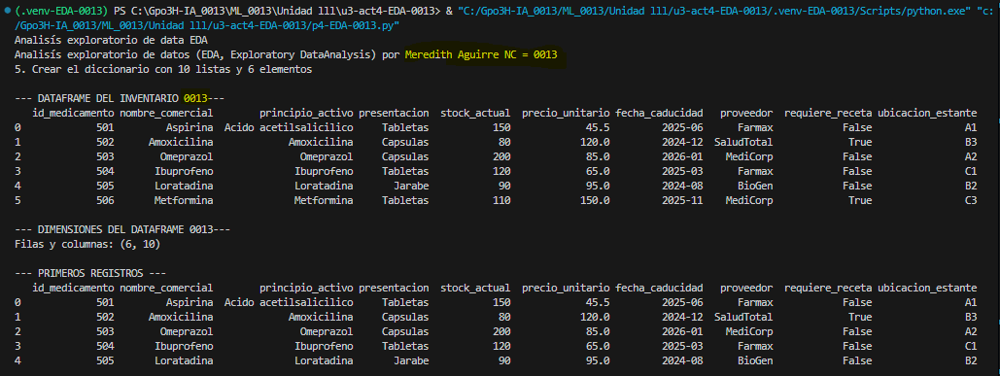
## 7. Convertir el DataFrame en archivo CSV
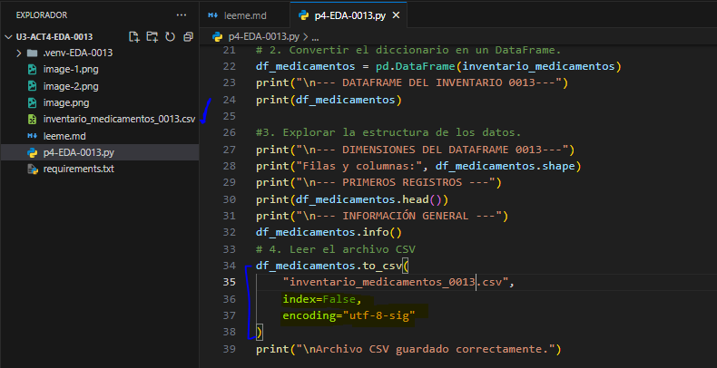
## Datos del CSV -->  Base de datos
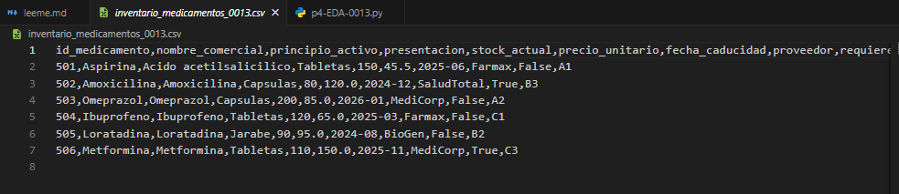
## Leer los datos desde el archivo CSV
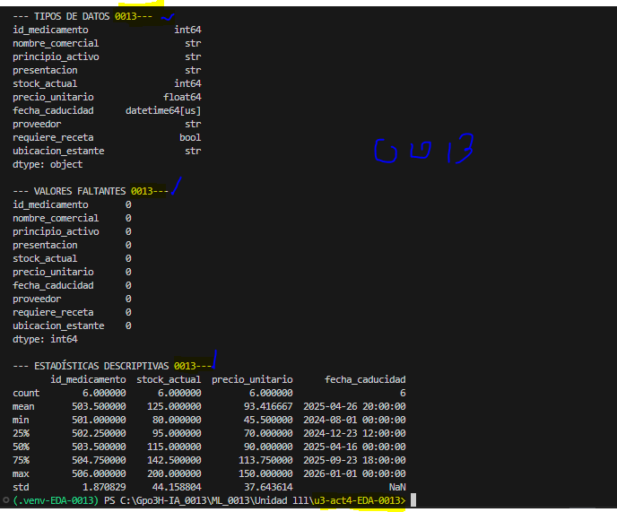
## Análisis Exploratorio de Datos (EDA)
### Primeros y últimos registros
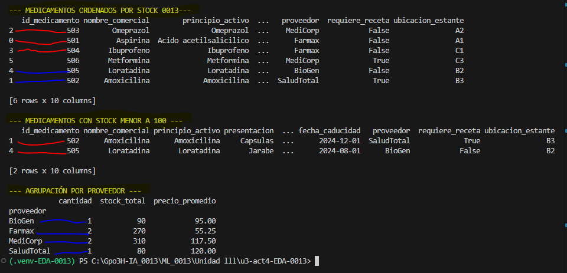
## GRÁFICA DE BARRAS: MEDICAMENTOS POR STOCK
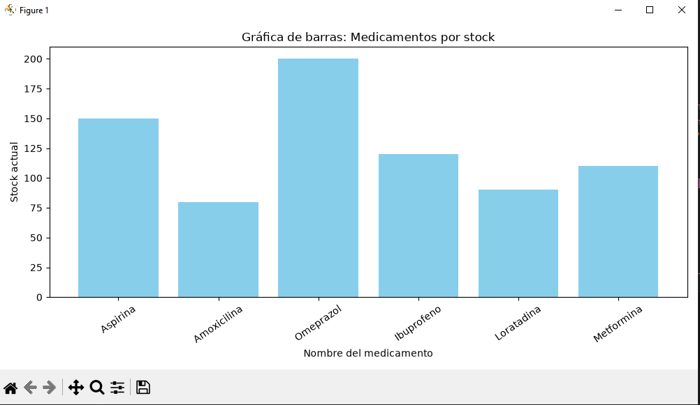
## GRÁFICA DE BARRAS: PRECIOS POR MEDICAMENTO
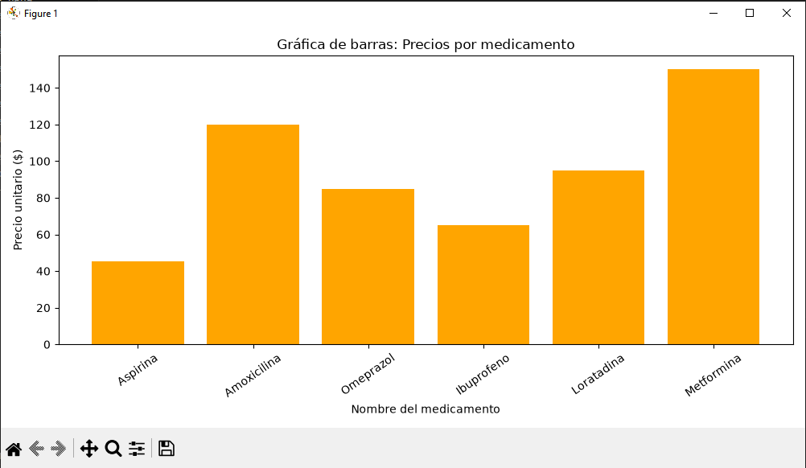
## HISTOGRAMA: DISTRIBUCIÓN DEL STOCK
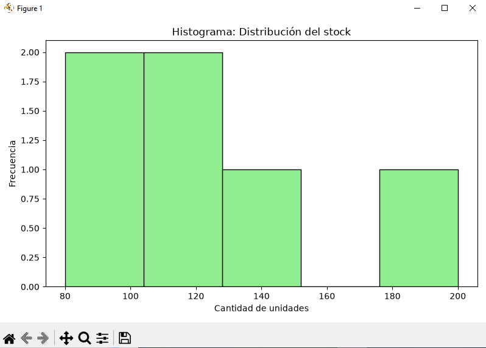
## GRÁFICA DE DISPERSIÓN: PRECIO VS STOCK
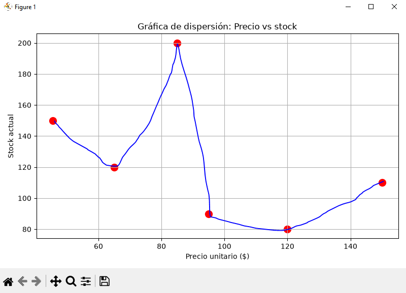
## DIAGRAMA DE CAJA: DISTRIBUCIÓN DEL STOCK
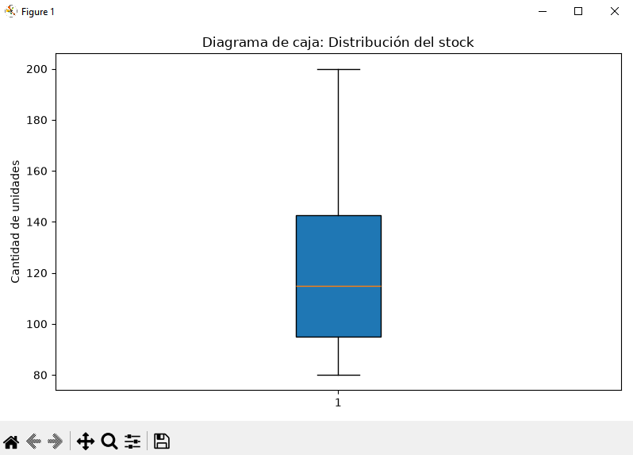
## MATRIZ DE CORRELACIÓN
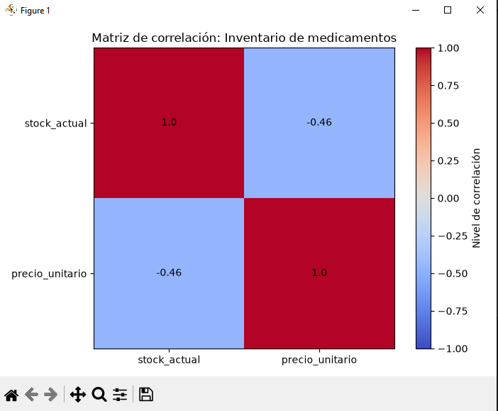